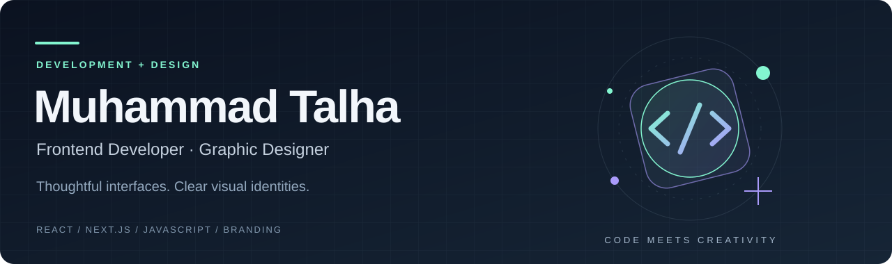

  

  <a href="https://mtalhacdx.github.io/Talha/"><strong>Explore my portfolio ↗</strong></a>
  &nbsp; · &nbsp;
  <a href="https://www.linkedin.com/in/muhammadtalha-se/">LinkedIn</a>
  &nbsp; · &nbsp;
  <a href="mailto:muhammad.talha@scholar.tu.edu.pk">Get in touch</a>

## Thoughtful design, practical development

I'm **Muhammad Talha**, a software engineering graduate and freelance graphic designer. I work across frontend development, branding, and UI design, bringing visual thinking to the way I build for the web.

My focus is **React, Next.js, JavaScript, and Tailwind CSS**. I'm also developing my backend skills with Node.js, Express, MongoDB, and REST APIs.

## Selected work

<table>
<tr>
<td width="50%" valign="top">
<h3><a href="https://github.com/mtalhacdx/Hafiz-G-Mobile">Hafiz G Mobile ↗</a></h3>

<strong>Inventory &amp; sales management</strong>

A business application with products, purchases, customers, suppliers, invoice printing, and reporting pages.

REACT · VITE · REDUX TOOLKIT · EXPRESS · MONGODB

</td>
<td width="50%" valign="top">
<h3><a href="https://github.com/mtalhacdx/Tag-Design-Tool">Tag Design Tool ↗</a></h3>

<strong>Design tools in the browser</strong>

A tag design interface combining canvas editing, tag listings, and print views.

JAVASCRIPT · FABRIC.JS · HTML · CSS · TAILWIND CSS

</td>
</tr>
<tr>
<td width="50%" valign="top">
<h3><a href="https://github.com/mtalhacdx/Social_Media_Website">SnapCircle ↗</a></h3>

<strong>Social networking project</strong>

Accounts, posts, image uploads, comments, user profiles, and search in a PHP and MySQL application.

PHP · MYSQL · BOOTSTRAP · JAVASCRIPT

</td>
<td width="50%" valign="top">
<h3><a href="https://github.com/mtalhacdx/Talha">Personal Portfolio ↗</a></h3>

<strong>Development &amp; creative services</strong>

My portfolio and service pages, bringing development, graphic design, and UI work together.

HTML · CSS · JAVASCRIPT

</td>
</tr>
</table>

[Browse my public repositories →](https://github.com/mtalhacdx?tab=repositories)

## My toolkit

| Development | Design |
| :--- | :--- |
| React · Next.js · JavaScript | Brand identity · UI/UX |
| HTML · CSS · Tailwind CSS | Print & marketing materials |
| Git · GitHub · Visual Studio Code | Photoshop · Illustrator · Figma |

## Beyond the code

I created the **logo and visual identity for [NeuroScope](https://github.com/ahmadrazacdx/neuro-scope)**, credited in the project's acknowledgements. It's an example of how my design work connects with software projects.

---

<strong>Have a frontend or design project in mind?</strong> 
<a href="mailto:muhammad.talha@scholar.tu.edu.pk">Let's discuss it</a>
&nbsp; · &nbsp;
<a href="https://mtalhacdx.github.io/Talha/">View my portfolio</a>

